# Waveshare 3.49 Growspace Display

ESPHome LVGL firmware and SDL2 desktop simulator for the **Waveshare ESP32-S3-Touch-LCD-3.49** (640×172 landscape). Built for monitoring indoor cultivation environments managed by [Growspace Manager](https://github.com/holt-dev/growspace_manager) in Home Assistant, paired with a **Music Assistant** controller, interactive **Claude Code** & **Codex** AI status/approval cards, an **Aurora** idle lock clock, and a local **Voice Satellite**.

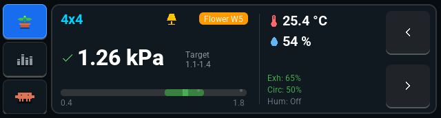

---

## Features & Showcase

### 1. Growspace Monitor (`Growspace` Display View)
- **Auto-cycling multi-growspace dashboard** (7 growspaces configured by default: `4x4`, `SOG 2x5`, `Nursery Dome`, `Clone`, `Mother`, `Dry`, `Cure`).
- **Live climate & VPD gauge**: Temperature, humidity, and calculated VPD plotted against configurable `vpd_gauge_min` (`0.4`) / `vpd_gauge_max` (`1.8`) and stage-specific target/danger bands, with an animated sidebar sprout/fan/droplet status icon.
- **Grow Stage & equipment status**: Displays current Grow Stage, day/night state, veg/flower week, and live exhaust, circulation, and humidifier states.
- **Hybrid Home Assistant integration**: Subscribes directly to live climate/actuator entities while using a lightweight **Metrics Bridge** template sensor to flatten nested Growspace Manager v1.3.1+ `metrics` attributes (see [ADR-0001](docs/adr/0001-hybrid-ha-metrics-bridge.md)).

### 2. Music Assistant Controller (`Music` Display View)
- Binds to any Home Assistant `media_player` entity (`music_player_entity`) or [`ha_music_bridge.yaml`](ha_music_bridge.yaml) for automatic active-player detection.
- Touch controls for play/pause, previous/next track, shuffle, repeat (`off` / `all` / `one`), volume, and mute.
- Two selectable LVGL card variants via `music_variant`:

| **`studio`** *(default)* — EQ & 12-band 10 Hz spectrum meter console ([`music/studio.yaml`](music/studio.yaml)) |
|---|
| 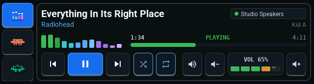 |

| **`deck`** — Animated vinyl turntable with 10 Hz strobe ([`music/deck.yaml`](music/deck.yaml)) |
|---|
| 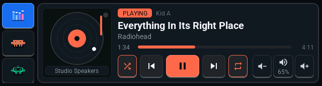 |

### 3. Claude Code AI Bridge (`AI` Display View)
- Connects local Claude Code sessions (CLI and Desktop) to the display via [`claude_bridge/claude_ha_bridge.py`](claude_bridge/claude_ha_bridge.py) and Home Assistant `input_text` helpers.
- Surfaces live session states: `Working`, `Pending Approval`, `Needs Input`, `Done`, and `Rate Limited` (with 5h/7d countdown bar and reset time).
- **Touchscreen Permission Requests**: When Claude Code requests tool/command permission, the display switches to the `AI` view and lets you tap **APPROVE** or **REJECT** (fires `esphome.claude_command` back to the waiting hook; silently falls back to the normal Claude prompt after `claude_decision_timeout`, default `110s`).
- **Two-Way Claude Channel (`claude/channel`)**: Run `claude_ha_bridge.py channel` as an MCP Channel server (see [ADR-0007](docs/adr/0007-hybrid-claude-channel-and-global-hooks.md)) to send prompts or answers from the **Voice Satellite** (`script.send_to_claude` in [`ha_assist_tools.yaml`](ha_assist_tools.yaml)) into the active CLI session and receive concise replies (`reply_to_device`) on the display and speaker.

| State / Variant | Preview |
|---|---|
| **`stage`** *(default on hardware)* — Mascot-forward animated Clawd puppet ([`claude/stage.yaml`](claude/stage.yaml), [`claude/clawd.h`](claude/clawd.h)) | 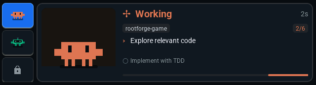 |
| **Permission Request** — Interactive Approve / Reject touchscreen prompt | 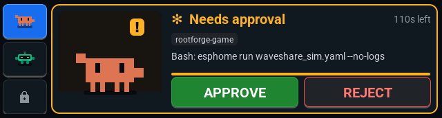 |
| **Rate Limited** — 5h / 7d usage limit countdown & reset time | 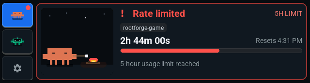 |
| **`terminal`** *(default on simulator)* — Compact CLI status line ([`claude/terminal.yaml`](claude/terminal.yaml)) | 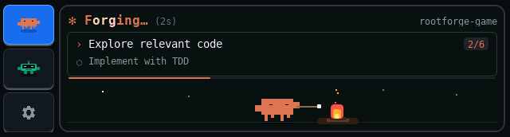 |

#### Activity Dioramas (`claude_variant` & `codex_variant`)
Select `fishing`, `mining`, `pingpong`, or `campfire` (or `terminal_fishing`, `terminal_mining`, `terminal_pingpong`, `terminal_campfire` for the compact terminal layout on the `540 px` floor) from [`pet_scenes.h`](pet_scenes.h):

| `fishing` | `mining` |
|---|---|
| 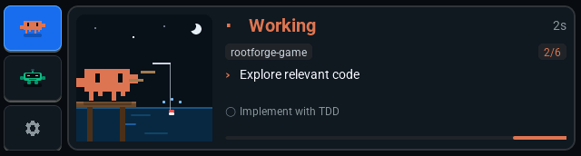 | 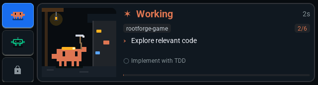 |
| **`pingpong`** | **`campfire`** |
| 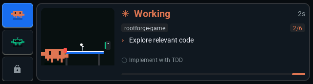 | 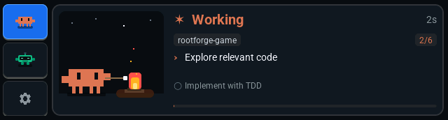 |

### 4. Codex Desktop Bridge (`Codex` Display View)
- Connects local Codex sessions to the display via [`codex_bridge/codex_ha_bridge.py`](codex_bridge/codex_ha_bridge.py), featuring the **Byte** mascot ([`codex/codex_pet.h`](codex/codex_pet.h)).
- Supports the same selectable variants via `codex_variant` (`stage`, `terminal`, `fishing`, `mining`, `pingpong`, `campfire`, and `terminal_*`), live turn/plan progress, and touchscreen permission decisions.

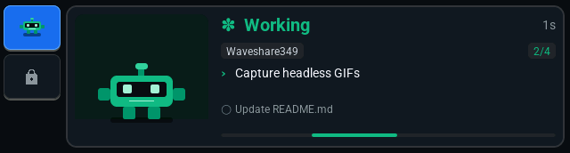

### 5. Idle / Lock Clock Screen (`idle_variant: aurora`)
- Automatically engages after `idle_timeout` (default `300s`) or when tapping the lock button in the nav rail, and automatically unlocks on incoming Claude/Codex activity.
- Displays battery arc & percentage, live clock and date, Wi-Fi signal strength & SSID, and tap-to-unlock ([`idle/aurora.yaml`](idle/aurora.yaml)).

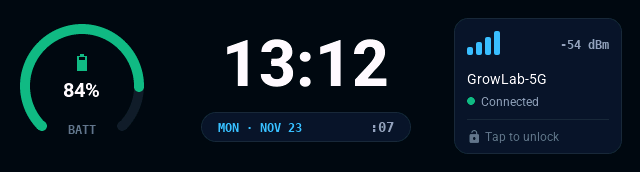

### 6. Voice Satellite & Local Assist Pipeline
- **On-device wake word & audio** ([`waveshare_349.yaml`](waveshare_349.yaml)): `micro_wake_word` (`okay_nabu`), ES8311 I2S audio codec, noise suppression, auto-gain, push-to-talk (`on_voice_ptt`), and a `Mute Microphone` switch (`mic_mute_switch`).
- **Full-stage Voice AI Activation UI** ([`packages/waveshare_349/mod_voice.yaml`](packages/waveshare_349/mod_voice.yaml), [`voice/voice_icon.h`](voice/voice_icon.h)): Pinned 10 Hz acoustic waveform & neural spark in the sidebar (`nav_mic`) paired with a `560 × 160` card-aligned activation stage for `Listening`, `Thinking`, `Speaking` (with wrapped multi-line TTS output), `Muted`, and `Error` states, plus tap-to-cancel/dismiss.
- **100% local server pipeline** (see [ADR-0002](docs/adr/0002-voice-satellite-ha-local-llm.md) & [`ha_assist_tools.yaml`](ha_assist_tools.yaml)): Designed for Home Assistant Assist with Wyoming `faster-whisper` (STT), Ollama tool-calling LLM (e.g., `qwen2.5:7b` / `qwen3:8b`), and Wyoming `piper` (TTS).
- **Declarative Display View control**: Exposes `select.<device>_display_view` (`Growspace`, `Music`, `AI`, `Codex`) so voice commands and Automations can switch screens directly.

| Voice Activation Flow (`Idle` → `Listening` → `Thinking` → `Speaking`) |
|---|
| 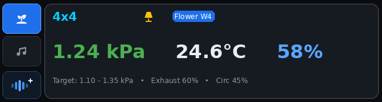 |

| Edge States (`Mic Muted` & `Voice Error`) |
|---|
| 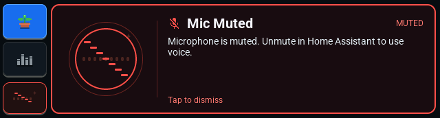 |

### 7. Labyrinth (`Labyrinth` Display View)

Open **Labyrinth** immediately before **Settings** in the navigation rail. Hold the Waveshare comfortably and tap **Start** to set your neutral tilt. Tilt the device to roll the marble into the gold Goal Hole and avoid the dark Trap Holes. Tap **Play again** after a win or loss.

Labyrinth is enabled in the main Waveshare firmware and Full Suite preset. Custom Waveshare builds can select the [Labyrinth Feature Module](packages/waveshare_349/mod_labyrinth.yaml) in the setup wizard. The game uses the onboard QMI8658 and requires ESPHome 2026.7.0 or later.

---

## Hardware & Pinout

Target board: **Waveshare ESP32-S3-Touch-LCD-3.49** (`esp32-s3-devkitc-1`, ESP-IDF, 240 MHz, 80 MHz Octal PSRAM).

| Subsystem | Interface / Chip | Pins |
|---|---|---|
| Display | QSPI (`WAVESHARE-ESP32-S3-TOUCH-LCD-3.49`, 172×640 rotated 90°) | CLK `GPIO10`, D0–D3 `GPIO11`–`GPIO14`, CS `GPIO9`, RST `GPIO21` |
| Touchscreen | I²C (`axs15231`) | SDA `GPIO17`, SCL `GPIO18` |
| System I²C | I²C (`sys_i2c`) | SDA `GPIO47`, SCL `GPIO48` |
| Motion sensor | QMI8658 on `sys_i2c` | Address `0x6A` |
| Audio Codec & I²S | `es8311` + I²S Mic & Speaker (16-bit, 16 kHz) | LRCLK `GPIO46`, BCLK `GPIO15`, MCLK `GPIO7`, DIN `GPIO45`, DOUT `GPIO6` |

---

## Getting Started

### Prerequisites
- [ESPHome](https://esphome.io/) 2025.11.0 or later for local builds and ESPHome Builder. Builds with Labyrinth require 2026.7.0 or later. The wizard can flash prebuilt USB presets directly.
- [Home Assistant](https://www.home-assistant.io/) with [Growspace Manager](https://github.com/holt-dev/growspace_manager) (v1.3.1+) *(if enabling the `Growspace` Feature Module)*
- *(Optional, for desktop simulator)* SDL2 development headers (`libsdl2-dev` on Debian/Ubuntu)
- *(Optional, for Claude Code / Codex bridges)* Python 3 with `websockets` / `requests` and hook configuration

### Option A: Setup & Build Wizard (Recommended)

Use the hosted **[Setup & Build Wizard](https://venosta-web.github.io/waveshare349/)** ([`site/`](site/)) to configure your build interactively without editing YAML by hand:

1. **Select a Target Device**
   | Target Device | Resolution | Hardware Notes |
   |---|---|---|
   | **Waveshare 3.49"** (`waveshare-349`) | `640 × 172` | ESP32-S3 with Octal PSRAM, ES8311 I2S audio, and QMI8658 motion sensor. Supports all 8 Feature Modules. |
   | **480×320 Prototype** (`prototype-480x320`) | `480 × 320` | ESP32-S3 16MB with Octal PSRAM and backlight PWM. Supports Growspace, Music, Claude, Codex, Idle Lock, and Settings. |

2. **Pick Feature Modules (or a Preset)**
   Enable only the capabilities you need—single-view builds automatically hide the navigation rail—or start from a pre-configured **Preset** (`Full Suite`, `Grow + Voice`, `Grow + Music`, `AI Desk Companion`, `Grow Only`, etc.):
   | Feature Module | Kind | Capability |
   |---|---|---|
   | **Growspace** (`grow`) | Display View | VPD gauge, target range, temp/humidity, equipment status, and auto-cycling across 1–7 growspaces |
   | **Music Assistant** (`music`) | Display View | Media player controls, track info, shuffle/repeat, and volume (`studio` or `deck` layout) |
   | **Claude Code** (`claude`) | Display View | Live agent status, step tracker, rate-limit countdown, and touch Approve/Reject for Permission Requests |
   | **Codex** (`codex`) | Display View | OpenAI Codex status, step tracker, and touch Approve/Reject for Permission Requests |
   | **Voice Satellite** (`voice`) | Assist Pipeline | On-device `Okay Nabu` wake word, ES8311 I2S audio, push-to-talk, and voice overlay *(Waveshare 3.49" only)* |
   | **Idle Lock Screen** (`idle`) | Lock Overlay | `Aurora` ambient clock and status overlay with configurable inactivity timeout and manual lock |
   | **Labyrinth** (`labyrinth`) | Display View | Tilt-controlled marble maze *(Waveshare 3.49" only)* |
   | **Device Settings** (`settings`) | Display View | On-device Display (brightness, lock timeout), Growspace (auto-cycle, speed), and System (telemetry, safe restart) menu |

3. **Customize Configuration & Generate `esphome.yaml`**
   - Set your `device_name` and `friendly_name`.
   - Choose **Package Source**: **GitHub Remote Packages** (for standalone pasting into ESPHome Builder) or **Local Repo Paths** (`packages/...` for local CLI builds).
   - Choose Wi-Fi provisioning (**Improv Wi-Fi & Captive Portal** for Web Serial flashing, or `!secret wifi_ssid` / `!secret wifi_password`) and optional `!secret api_encryption_key`.
   - Configure module-specific `substitutions` (growspace count/names/intervals, `music_variant`, `claude_variant`, `codex_variant`, `idle_timeout`, etc.).
   - **Copy** or **Download** the generated `esphome.yaml` and compile with ESPHome Builder or `esphome run <file>.yaml`.

4. **Flash Firmware & Follow Home Assistant Setup**
   - If your selected Target Device + Feature Modules match a CI-built **Preset**, you can flash it directly over USB in Chrome or Edge using **ESP Web Tools** right inside Step 4.
   - Step 4 also displays a **Home Assistant Companion Setup** checklist filtered to only the Feature Modules you enabled.

### Option B: Manual CLI Setup

#### 1. Home Assistant Setup

1. **Metrics Bridge** — Include [`ha_metrics_bridge.yaml`](ha_metrics_bridge.yaml) in your Home Assistant `configuration.yaml` (e.g., via `packages:`) and update the source `sensor.<growspace>` entity IDs to match your Overview Sensors.
2. **Music Bridge *(optional)*** — Include [`ha_music_bridge.yaml`](ha_music_bridge.yaml) to auto-detect the active Music Assistant player and remember the last one used.
3. **Assist Tools *(optional)*** — Include [`ha_assist_tools.yaml`](ha_assist_tools.yaml) in your Home Assistant scripts and expose the following to Assist under **Settings → Voice assistants → Expose**:
   - `select.waveshare_349_voice_display_view`
   - `media_player.music_assistant_player` (or your configured player)
   - `script.switch_display_view`
   - `script.open_music_view_and_play`
   - `script.send_to_claude`

#### 2. Configure & Flash the Device

1. Edit the `substitutions:` block at the top of [`waveshare_349.yaml`](waveshare_349.yaml) (or pick a composable preset under [`presets/`](presets/)):
   - Set `wifi_ssid` and `wifi_password`
   - Adjust `gs_count` and `gs_0_*` … `gs_6_*` entity IDs
   - Set `music_player_entity`, `music_variant` (`studio` | `deck`), `claude_variant`, and `codex_variant`
2. Compile and upload via ESPHome:
   ```bash
   esphome run waveshare_349.yaml
   ```
3. Add the discovered ESPHome device in Home Assistant (**Settings → Devices & services → ESPHome**). If using the Claude Code or Codex bridge, open **Configure** on the device integration and enable **Allow the device to perform Home Assistant actions**.

### 3. Run the Desktop SDL2 Simulator

Test the full LVGL UI and Home Assistant connection on Linux/WSL/macOS without flashing hardware:

```bash
# Install SDL2 (Debian/Ubuntu)
sudo apt-get install -y libsdl2-dev

# Run the 640x172 SDL2 simulator (API listens on TCP 6053)
esphome run waveshare_sim.yaml
```

- Press **`F12`** inside the simulator window to save a PNG screenshot.
- Override card variants on the fly (note `-s` flags go before `run`):
  ```bash
  esphome -s claude_variant stage -s music_variant deck run waveshare_sim.yaml
  ```

### 4. Set Up the Claude Code Bridge *(optional)*

See [`claude_bridge/README.md`](claude_bridge/README.md) for full details. Quick summary:

1. Create a Home Assistant Long-Lived Access Token and save `HA_TOKEN=...` in `~/.config/claude-ha-bridge/config.env` (`chmod 600`).
2. Create the required `input_text` helpers in Home Assistant:
   ```bash
   python3 claude_bridge/claude_ha_bridge.py setup
   ```
3. Verify the connection and test display taps:
   ```bash
   python3 claude_bridge/claude_ha_bridge.py check
   python3 claude_bridge/claude_ha_bridge.py test
   ```
4. Merge [`claude_bridge/hooks.example.json`](claude_bridge/hooks.example.json) into the `"hooks"` key of `~/.claude/settings.json`.
5. *(Optional, for two-way Voice Satellite prompts & replies)* Register the **Claude Channel** globally and launch CLI sessions with it enabled:
   ```bash
   claude mcp add --scope user waveshare-display -- \
     /usr/bin/python3 /home/maxi/dev/EspHome/Waveshare349/claude_bridge/claude_ha_bridge.py channel
   claude --dangerously-load-development-channels server:waveshare-display
   ```
   To have `reply_to_device` speak replies to device-initiated turns, set `CLAUDE_TTS_ENTITY` (e.g. `tts.piper`) and `CLAUDE_TTS_SPEAKER` in `~/.config/claude-ha-bridge/config.env`.

### 5. Set Up the Codex Desktop Bridge *(optional)*

The **Codex** Display View shows local Codex turn status, plan steps, and optional touchscreen decisions for eligible permission requests. See [`codex_bridge/README.md`](codex_bridge/README.md) for Home Assistant helper setup, the desktop hooks, and the touchscreen test.

---

## Configuration Reference

Key `substitutions` shared across [`waveshare_349.yaml`](waveshare_349.yaml) and [`waveshare_sim.yaml`](waveshare_sim.yaml):

| Substitution | Default (HW / Sim) | Description |
|---|---|---|
| `gs_count` | `"7"` | Number of growspaces to cycle through |
| `cycle_interval` | `"15"` | Seconds between automatic growspace rotations |
| `pause_timeout` | `"25"` | Seconds to pause auto-cycle after manual interaction |
| `idle_timeout` | `"300"` | Seconds before locking to the idle clock screen |
| `idle_variant` | `"aurora"` | Idle clock layout: `"aurora"` |
| `vpd_gauge_min` / `vpd_gauge_max` | `"0.4"` / `"1.8"` | VPD gauge scale bounds (kPa) |
| `music_variant` | `"studio"` | Music card layout: `"studio"` or `"deck"` |
| `music_player_entity` | `"media_player.music_assistant_player"` / `"sensor.music_assistant_bridge"` | Home Assistant media player or Music Bridge entity ID |
| `claude_variant` | `"stage"` / `"terminal"` | AI card layout: `"stage"`, `"terminal"`, `"fishing"`, `"mining"`, `"pingpong"`, `"campfire"`, or `"terminal_*"` |
| `claude_decision_timeout` | `"110"` | Seconds the Claude bridge waits for an Approve/Reject tap |
| `codex_variant` | `"stage"` / `"terminal"` | Codex card layout: `"stage"`, `"terminal"`, `"fishing"`, `"mining"`, `"pingpong"`, `"campfire"`, or `"terminal_*"` |
| `codex_decision_timeout` | `"110"` | Seconds the Codex bridge waits for an Approve/Reject tap |

---

## Headless Previews & GIF Generation

Record automated state walkthroughs as animated GIFs without a physical screen:

```bash
# Growspace Monitor preview (outputs to out/)
ESPHOME_SNAPSHOT_DIR=out esphome run grow_preview.yaml

# Music card preview (outputs to out/)
ESPHOME_SNAPSHOT_DIR=out esphome -s music_variant studio run music_preview.yaml
ESPHOME_SNAPSHOT_DIR=out esphome -s music_variant deck run music_preview.yaml

# Claude AI card preview (outputs to out/)
ESPHOME_SNAPSHOT_DIR=out esphome -s claude_variant stage run preview.yaml
ESPHOME_SNAPSHOT_DIR=out esphome -s claude_variant terminal run preview.yaml

# Codex card preview (outputs to out/)
ESPHOME_SNAPSHOT_DIR=out esphome -s codex_variant stage run codex_preview.yaml

# Idle lock clock preview (outputs to out/)
ESPHOME_SNAPSHOT_DIR=out esphome run idle_preview.yaml
```

---

## Repository Structure

```text
.
├── waveshare_349.yaml          # Hardware firmware config (ESP32-S3 + ES8311 + LVGL + Wake Word)
├── waveshare_sim.yaml          # Desktop SDL2 simulator config (640x172)
├── grow_preview.yaml           # Headless snapshot runner for Growspace Monitor states
├── music_preview.yaml          # Headless snapshot runner for Music card states
├── preview.yaml                # Headless snapshot runner for Claude AI card states
├── codex_preview.yaml          # Headless snapshot runner for Codex card states
├── idle_preview.yaml           # Headless snapshot runner for Idle lock clock
├── ha_metrics_bridge.yaml      # Home Assistant template sensors (Metrics Bridge)
├── ha_music_bridge.yaml        # Home Assistant template sensor (Music Bridge)
├── ha_assist_tools.yaml        # Home Assistant Assist scripts for local LLM control
├── pet_scenes.h                # Shared activity diorama scenes (fishing, mining, pingpong, campfire)
├── packages/
│   ├── common/                 # Shared Wi-Fi packages (static / Improv)
│   ├── prototype_480x320/      # Composable Feature Modules for 480x320 Prototype
│   └── waveshare_349/          # Composable Feature Modules (board, core_ui, mod_*)
├── presets/                    # Ready-to-flash device presets
├── site/                       # GitHub Pages Setup & Build Wizard (YAML generator + ESP Web Tools)
├── claude/                     # Clawd mascot header & Claude card variants
├── claude_bridge/              # Claude Code <-> Home Assistant hook bridge & tests
├── codex/                      # Byte mascot header & Codex card variants
├── codex_bridge/               # Codex <-> Home Assistant hook bridge & tests
├── music/                      # Music Assistant card variants (studio, deck)
├── idle/                       # Idle lock clock variants (aurora)
├── fonts/                      # Bundled DejaVu & Material Design Icons fonts
├── docs/
│   ├── adr/                    # Architecture Decision Records
│   └── images/                 # Animated GIF captures for README showcase
├── CONTEXT.md                  # Domain glossary and terminology
└── .github/workflows/
    ├── esphome-lint.yml        # CI validation with `esphome config`
    └── pages-wizard.yml        # CI preset firmware builds & GitHub Pages deployment
```

---

## Validation & Testing

- **ESPHome config validation** (mirrors [`.github/workflows/esphome-lint.yml`](.github/workflows/esphome-lint.yml)):
  ```bash
  for f in *.yaml presets/*.yaml; do
    grep -Eq '^(esphome|packages):' "$f" && esphome config "$f"
  done
  ```
- **Bridge unit tests**:
  ```bash
  python3 -m unittest claude_bridge/test_claude_ha_bridge.py
  python3 -m unittest codex_bridge/test_codex_ha_bridge.py
  ```

---

## License

Licensed under the **GNU General Public License v3.0** — see [`LICENSE`](LICENSE) for details.
